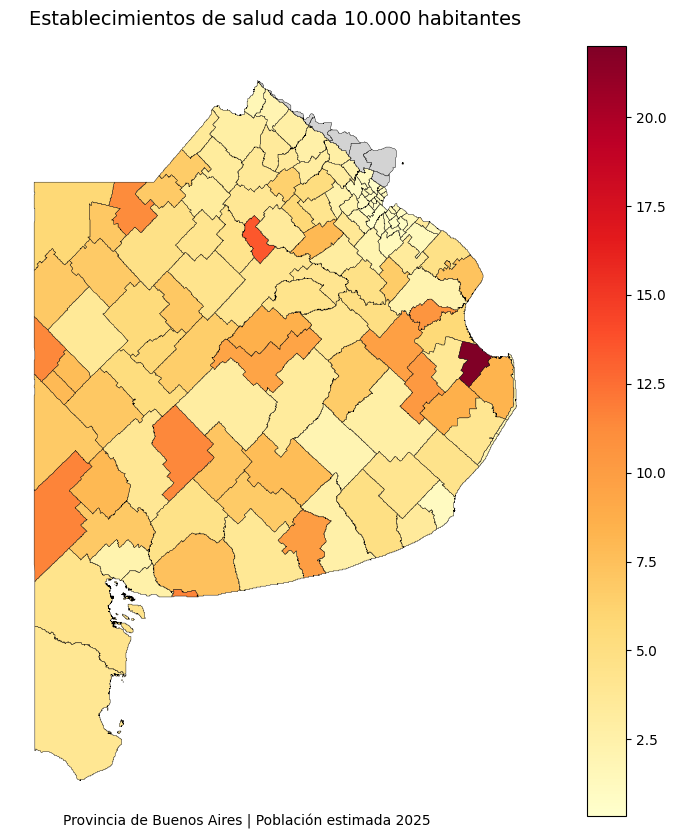

# Distribución territorial de establecimientos públicos de salud en la Provincia de Buenos Aires

**¿La oferta pública de salud acompaña a la población?**

Análisis geoespacial de 2.840 establecimientos públicos de salud en los partidos bonaerenses, en relación con la población estimada 2025.

Bioq. María Jimena Benito Nacir — Junio 2026

[](https://colab.research.google.com/github/jimena-benito-nacir/distribucion-establecimientos-salud-pba/blob/main/Distribucion_territorial_establecimientos_salud_pcia_BuenosAires.ipynb)

---

## Descripción

Los partidos de la Provincia de Buenos Aires difieren en población, superficie y grado de urbanización. Este proyecto analiza cómo se distribuyen los establecimientos públicos de salud (nacionales, provinciales y municipales) en el territorio y si esa distribución acompaña a la población de cada partido.

Se integran tres fuentes abiertas del Portal de Datos Abiertos de la Provincia de Buenos Aires:

- **Establecimientos públicos de salud:** 2.840 establecimientos georreferenciados como puntos.
- **Límites de partidos:** 143 polígonos de la cartografía oficial.
- **Población por partido:** censos y proyecciones 2010-2025. Se usa la estimación 2025 (18.359.753 habitantes en la provincia).

## Pregunta del proyecto

¿La distribución territorial de los establecimientos públicos de salud acompaña la distribución de la población entre los partidos bonaerenses?

## Resultado principal

Todos los números salen del notebook.

| Indicador | Valor |
|---|---:|
| Establecimientos analizados | 2.840 |
| Establecimientos asignados a un partido | 2.824 (99,4 %) |
| Establecimientos sin partido asignado | 16 |
| Partidos con dato de población 2025 | 135 |
| Establecimientos cada 10.000 habitantes: promedio | 4,43 |
| Establecimientos cada 10.000 habitantes: mediana | 3,75 |
| Correlación población – cantidad de establecimientos | r = 0,81 |
| Correlación población – establecimientos cada 10.000 habitantes | r = −0,44 |

**Partidos con menor y mayor disponibilidad relativa** (establecimientos cada 10.000 habitantes):

| Menor disponibilidad | Valor | Mayor disponibilidad | Valor |
|---|---:|---|---:|
| La Matanza | 0,36 | Tordillo | 22,00 |
| Tigre | 0,66 | Alberti | 13,50 |
| Morón | 0,70 | Puan | 11,60 |
| Merlo | 0,70 | Monte Hermoso | 11,58 |
| Hurlingham | 0,76 | Pellegrini | 11,42 |

La Matanza tiene 91 establecimientos para 2.509.547 habitantes: uno cada ~27.600 personas. Tordillo tiene 4 para 1.818 habitantes: los valores altos reflejan poblaciones pequeñas más que redes grandes.

### Conclusión

- En números absolutos, la oferta acompaña a la población: donde vive más gente hay más establecimientos.
- En términos relativos, no: cuanto más poblado es un partido, menos establecimientos tiene cada 10.000 habitantes. El conurbano muestra la menor disponibilidad relativa.
- Los indicadores estandarizados por población cambian la lectura que dan los números absolutos.
- Un valor alto no siempre indica mejor acceso: en partidos muy poco poblados, el indicador se eleva por el tamaño de la población.



## Estructura del repositorio

```text
.
├── README.md
├── Distribucion_territorial_establecimientos_salud_pcia_BuenosAires.ipynb   # notebook ejecutado de punta a punta
├── requirements.txt
├── LICENSE                        # licencia del código
├── .gitignore
├── datos/
│   ├── README.md                  # fuentes y archivos esperados
│   ├── establecimientos_salud_publicos/
│   │   └── Establecimientos_salud_publicos_alta_al20220721.shp (+ .shx, .dbf, .prj, .cpg)
│   ├── limites-partidos/
│   │   └── partidos.geojson
│   └── proyecciones-poblacion-2010_2025.csv
├── results/                       # figuras generadas por el notebook
│   └── README.md
└── docs/
    └── Presentacion_Distribucion_Establecimientos_Salud_PBA.pdf
```

## Flujo del análisis

| Etapa | Qué se hace |
|---|---|
| Exploración | Estructura, faltantes y tipos de cada dataset |
| Limpieza | Columnas vacías, fila del total provincial, selección de la población 2025 |
| Normalización | Nombres de partidos sin tildes, mayúsculas ni espacios, como clave común. Cuatro nombres se concilian a mano entre bases (por ejemplo, «Nueve de Julio» y «9 de Julio») |
| Unión espacial | Cada establecimiento se asigna al partido que lo contiene (`gpd.sjoin`, `predicate="within"`) |
| Control de calidad | Revisión de 15 establecimientos asignados a dos partidos a la vez; cada caso se resuelve con verificación documental, para que ninguno se cuente dos veces |
| Indicador | Establecimientos cada 10.000 habitantes |
| Análisis | Estadística descriptiva, valores atípicos, correlaciones y rankings |
| Visualización | Mapa de puntos, mapa coroplético, mapa interactivo con `folium` y gráfico de ranking |

## Cómo ejecutar

El notebook está preparado para Google Colab y lee los datos desde Google Drive.

1. Descargar la carpeta `datos/` de este repositorio.
2. Subirla a la raíz de **Mi unidad** en Google Drive, para que quede en `MyDrive/datos/`.
3. Abrir el notebook con el botón **Abrir en Colab** de arriba.
4. Ejecutar **Entorno de ejecución → Ejecutar todas** y autorizar el acceso a Google Drive cuando se solicite.

El mapa interactivo de `folium` se visualiza al ejecutar el notebook; la vista previa de GitHub no lo muestra.

## Limitaciones

- Los partidos insulares quedaron fuera del indicador por falta de datos poblacionales en la fuente.
- 16 establecimientos (0,56 %) no quedaron dentro de ningún partido en la unión espacial.
- El indicador mide cantidad de establecimientos, no capacidad, complejidad ni accesibilidad geográfica.
- El dataset de establecimientos corresponde a altas al 21/07/2022; la población es la estimación 2025.

## Próximos pasos

- **Factores socioeconómicos:** cruzar con indicadores como pobreza o densidad poblacional para explicar las disparidades.
- **Accesibilidad geográfica:** medir distancias y tiempos de traslado a los establecimientos.
- **Nivel de complejidad:** distinguir centros de atención primaria de hospitales usando la categoría de cada establecimiento.

## Herramientas

Python · pandas · GeoPandas · Matplotlib · folium

## Referencias

- Gobierno de la Provincia de Buenos Aires. Portal de Datos Abiertos:
  - *Establecimientos públicos de salud*. https://catalogo.datos.gba.gob.ar/dataset/establecimientos-salud
  - *Límites de partidos de la Provincia de Buenos Aires*. https://catalogo.datos.gba.gob.ar/dataset/partidos
  - *Población, censos 2010 y 2022, y proyecciones 2010-2025*. https://catalogo.datos.gba.gob.ar/dataset/poblacion
- Ministerio de Salud de la Provincia de Buenos Aires. *Guía de establecimientos asistenciales, subsector oficial, año 2013*. https://www.ms.gba.gov.ar/ssps/repositorio/libros/elec110.pdf
- Documentación de GeoPandas, pandas, Matplotlib y folium.

Las fuentes de la verificación documental de cada caso se detallan en el notebook.

## Licencia

El código se publica bajo licencia MIT (ver `LICENSE`). Los datos pertenecen al Gobierno de la Provincia de Buenos Aires y se rigen por los términos de uso de su Portal de Datos Abiertos; no están cubiertos por la licencia MIT.
